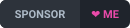
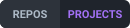
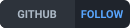

  <!-- Header Banner -->
  

  <!-- Animated Typing Subtitle -->
  

    
  

  <!-- Quick Badges -->
  

    
    
    
    
  

---

### 🏆 GitHub Achievements & Milestones

  <table align="center" style="border: none; border-collapse: collapse;">
    <tr style="border: none;">
      <td align="center" width="180" style="border: none; padding: 12px 16px;">
        <a href="https://github.com/Enard52?tab=achievements">
           
          <b>Pull Shark</b> 
          Gold x4
        </a>
      </td>
      <td align="center" width="180" style="border: none; padding: 12px 16px;">
        <a href="https://github.com/Enard52?tab=achievements">
           
          <b>Pair Extraordinaire</b> 
          Silver x3
        </a>
      </td>
      <td align="center" width="180" style="border: none; padding: 12px 16px;">
        <a href="https://github.com/Enard52?tab=achievements">
           
          <b>Galaxy Brain</b> 
          Gold x4
        </a>
      </td>
    </tr>
    <tr style="border: none;">
      <td align="center" width="180" style="border: none; padding: 12px 16px;">
        <a href="https://github.com/Enard52?tab=achievements">
           
          <b>Public Sponsor</b> 
          Unlocked
        </a>
      </td>
      <td align="center" width="180" style="border: none; padding: 12px 16px;">
        <a href="https://github.com/Enard52?tab=achievements">
           
          <b>Quickdraw</b> 
          Unlocked
        </a>
      </td>
      <td align="center" width="180" style="border: none; padding: 12px 16px;">
        <a href="https://github.com/Enard52?tab=achievements">
           
          <b>YOLO</b> 
          Unlocked
        </a>
      </td>
    </tr>
  </table>

---

### 👨‍💻 About Me 

- 🔭 **Current Focus:** Building autonomous AI agent architectures, Model Context Protocol (MCP) tooling, and developer infrastructure at **[OpenDevs Society](https://github.com/OpenDevs-Society)**.
- 💳 **Fintech & Payments:** Author of unified payment gateway solutions for Turkish providers (iyzico, PayTR, Parampos).
- 💬 **Ask Me About:** `TypeScript`, `Node.js`, `Python`, `Nuxt / Vue 3`, `FastAPI`, `MCP Servers`, and `Distributed Workflows`.
- ⚡ **Engineering Philosophy:** Clean architecture, type-safety, resilient automation, and crash-proof open-source software.
- 🌍 **Location:** Istanbul, Türkiye 🇹🇷
- 🚀 **Milestone:** Prolific open-source contributor with **1,100+ Merged Pull Requests** across active repositories!

---

### 🛠️ Tech Stack & Arsenal

  

 

<b>💻 Languages & Core Runtimes</b>

 

  

<b>⚡ Frameworks & Libraries</b>

 

  

<b>🤖 AI, Agentic Ecosystem & DevOps</b>

 

  

---

### 🌟 Featured Projects & Ecosystem

| Project | What it is | Stack |
| :--- | :--- | :--- |
| **[NEXUS](https://github.com/Enard52/NEXUS)** ⭐ | Local-first smart home: direct LAN device control, desktop tray automations, built-in AI assistant. No hub, no vendor cloud. Windows · Linux · macOS · Android · iOS. [Download](https://github.com/Enard52/nexus-releases/releases/latest) | JavaScript, Electron, Capacitor |
| **[better-payment](https://github.com/Enard52/better-payment)** | Unified, type-safe payment gateway for Node.js & TypeScript: one API for iyzico, PayTR, Parampos and Akbank. | TypeScript |
| **[market-data-sanity-checker](https://github.com/Enard52/market-data-sanity-checker)** | Trust layer for market data: validate, score and explain anomalies in OHLCV, dividends, splits & fundamentals. CLI + TypeScript SDK. | TypeScript |
| **[AynOps](https://github.com/Enard52/AynOps)** | Local MCP server that gives AI clients real-time cybersecurity reconnaissance capabilities. | Python |
| **[ci-stress-bench](https://github.com/Enard52/ci-stress-bench)** | High-throughput CI/CD stress-testing benchmark and pipeline simulation engine for Git workflows. | — |

---

### 📊 GitHub Activity

  

---

### 💖 Sponsor My Work

Maintaining open-source software takes substantial time, dedication, and server costs. By becoming a sponsor, you directly accelerate the development of free developer tools!

🎯 **Current Goal:** `$100 / month` to dedicate 10+ hours/week to library maintenance & community feature requests.

| Tier | Option | Benefits & Perks |
| :--- | :--- | :--- |
| ☕ **Supporter / Coffee** | **$5** (Monthly or One-time) | Official **Sponsor Badge** on your GitHub profile & my endless gratitude! |
| 🚀 **Backer / Booster** | **$25** (Monthly or One-time) | **Your name or logo** listed as a sponsor in project READMEs. |
| 🏢 **Champion / Enterprise** | **$100** (Monthly or One-time) | **Logo on README/website** + **Fast-tracked issue, bug & feature priority**. |

   
  

---

  
  Designed & engineered with ❤️ by <a href="https://github.com/Enard52">Ensar (Enard)</a>

